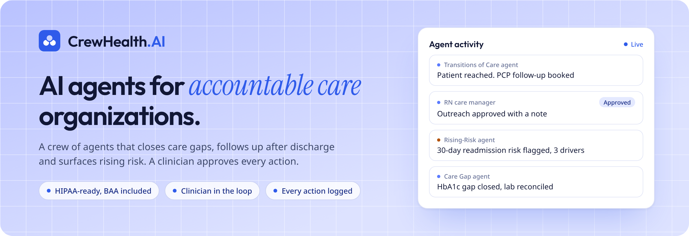
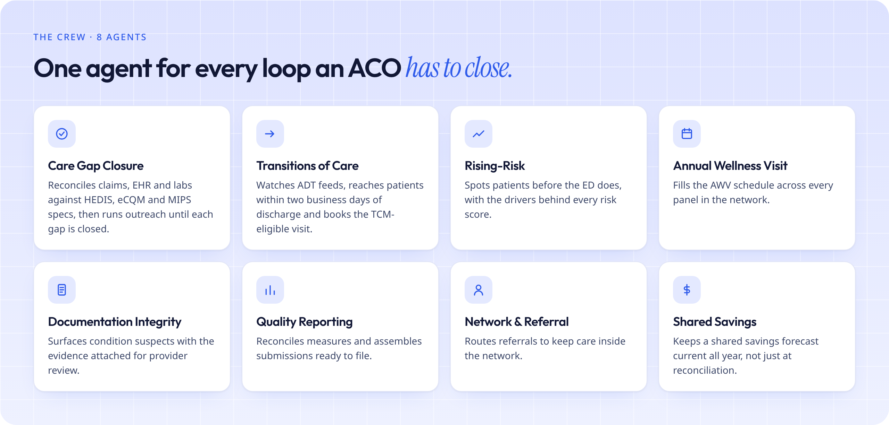

  

  
  
  

 

**CrewHealth.AI** runs a crew of AI agents across an ACO's attributed population. They close care gaps, follow up within two business days of discharge, surface rising risk and prepare quality submissions — and a clinician approves each action before anything leaves the system.

 

## From raw feeds to closed loops

| | Step | What happens |
|:-:|:--|:--|
| **01** | **Connect** | CCLF, payer claims, HL7 ADT, FHIR from your EHRs, labs and rosters land in one longitudinal record. |
| **02** | **Understand** | Measure, risk and attribution engines evaluate every life daily. Agents reason over the results with citations. |
| **03** | **Act** | Agents draft outreach, book visits, query providers and assemble submissions. Your policy decides what needs a person. |
| **04** | **Learn** | Outcomes flow back. Agents learn which channels and timings work, and finance sees the dollars attributed. |

 

  

 

## Built for clinical oversight

Autonomy is a dial, not a switch, and nothing leaves the system without a record.

- **Four autonomy levels** — *Suggest → Draft → Act with approval → Act*, set per workflow, per practice or per risk tier, and changed without a release.
- **Evidence on every action** — each recommendation cites the claim, note, lab or ADT message behind it. No evidence, no action.
- **A complete audit trail** — every read, draft, approval and submission is logged with who, what and why.
- **HIPAA-ready, BAA included** — PHI is encrypted in transit and at rest. Prompts carry only task fields. Your data never trains a shared model.

 

## See CrewHealth run on your population

Send a de-identified CCLF extract and we'll show the gaps, the risk and the shared savings an agent roster could reach in year one. We reply within one business day.

**[crewhealth.ai](https://crewhealth.ai)** · **[hello@crewhealth.ai](mailto:hello@crewhealth.ai)**

No patient data over email or GitHub, please. We set up a secure channel for data.

 

© 2026 CrewHealth.AI

